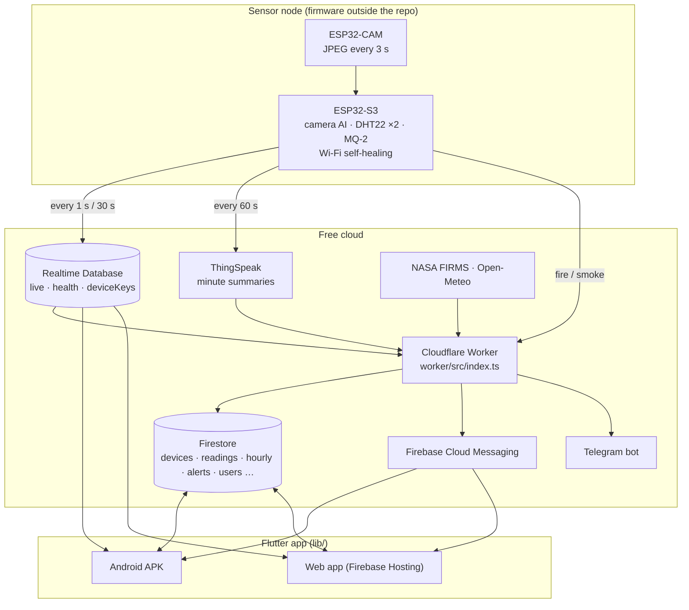
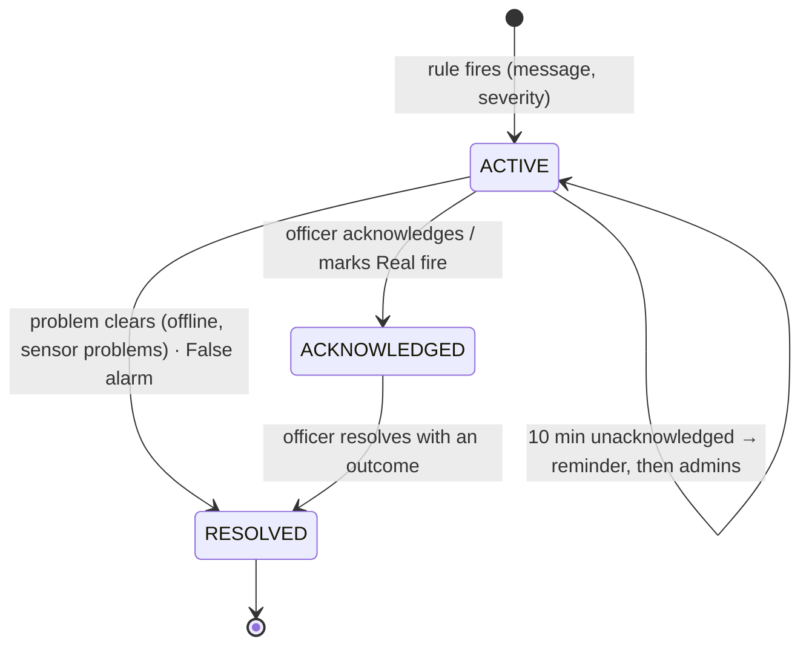

# Architecture — Forest Fire Monitor

## 1. Overview

## 2. Backend jobs

| Cron | Job | Module |
|---|---|---|
| `* * * * *` | ingest each ThingSpeak channel: risk, anomaly, air at the sensor, alert decision | `index.ts` `ingest`, `alertRules.ts`, `anomaly.ts`, `localAir.ts`, `terrain.ts` |
| `*/1 * * * *` | push new alerts (FCM, Telegram users, fire stations), admin requests, Telegram inbox | `fcm.ts`, `telegram.ts`, `fireServices.ts`, `nodes.ts` |
| `*/5 * * * *` | node online/offline, board-health alerts, role requests, heartbeat, escalation | `index.ts` `nodeHealth`, `health.ts` |
| `7 * * * *` | hourly rollups, fire danger (ML), satellite fires, spread | `fireDanger.ts`, `fwi.ts`, `weather.ts`, `firms.ts`, `spread.ts` |
| `23 21 * * *` | delete readings older than the retention period | `index.ts` |

Each run has its own budget of 50 sub-requests (Workers Free), which is why ingestion and push are separate crons.

## 3. Endpoints

| Method | Path | Purpose |
|---|---|---|
| POST | `/alert` | node alert: `{node, key, type, severity, aiClass, aiConfidence, temperature, humidity, mq2_1, mq2_2, riskScore}`; fire under 75% is ignored; duplicates fold into the open alert |
| POST | `/lora` | receiver gateway link report → `devices/{node}.lora` |
| POST | `/lora/data` | `{gateway, key, node, rssi, snr, packet}`: always stored in RTDB `lora/{node}`; when `live/{node}` is older than 30 s it becomes the live data, updates the device and history once a minute and raises fire/smoke alerts (75% rule) |
| GET | `/apk/version.json`, `/apk/*.apk` | static assets for in-app Android updates |
| GET | `/` | `Forest Fire backend worker-x.y.z` |

## 4. Alert lifecycle

Timeline fields on the alert: `detectedAt`, `pushedAt`, `fireServicesNotifiedAt`, `confirmedAt`, `escalatedAt`,
`ackAt`, `verdictAt`, `lastDetectedAt`, `resolvedAt`.

## 5. App

Flutter 3.47, Material 3, `flutter_map` (Esri imagery, NASA GIBS NDVI), `fl_chart`, Firebase (Auth, Firestore,
Realtime Database, Messaging).

| File | Role |
|---|---|
| `lib/screens/app_shell.dart` | tabs Home / Data / Alerts, fire pop-up, update banner, connection banner |
| `lib/screens/home_map_screen.dart` | map, layers, fire areas, sensor markers, directions, tap-to-place |
| `lib/widgets/live_overlay_strip.dart` | live panel: readings, camera, risk, air at sensor, fire prediction |
| `lib/widgets/node_details_sheet.dart` | sensor details from RTDB live + health |
| `lib/screens/data_screen.dart` · `widgets/trend_chart.dart` | graphs with zoom/pan, CSV |
| `lib/screens/alerts_screen.dart` · `reports_screen.dart` | alerts, verdicts, accuracy card, timeline, reports |
| `lib/services/node_repository.dart` | streams devices + alerts, alert actions, add sensor |
| `lib/services/report_export_service.dart` | PDF/CSV for alerts, CSV for readings |
| `lib/services/app_update.dart` | web build id / Android build number checks |

## 6. Security

| Layer | Rule |
|---|---|
| Firestore | sign-in to read; clients cannot write sensor data; alert transitions only by officers/admins with their uid and server time; admins manage devices, stations and requests; `config/*` backend-only |
| Realtime Database | signed-in users read `live`/`health`; nodes write only with their key and validated fields |
| Worker | node and gateway keys compared in constant time; service-account and bot token as Worker secrets |
| Secrets | firmware and keystore stay outside the repo ([docs/DEPLOYMENT.md](docs/DEPLOYMENT.md#7-secrets-checklist)) |

## 7. Performance and limits

| Item | Value |
|---|---|
| Camera AI on the S3 | ≈2.7 s per frame |
| Node alert → phone | ≈2 s |
| Live feed | 1 s; health 30 s; history 60 s |
| Firestore (Spark) | 50k reads, 20k writes, 20k deletes per day → ≈5 nodes, ≈10 people with the app open |
| Worker (free) | 100k requests/day, 50 sub-requests per run |
