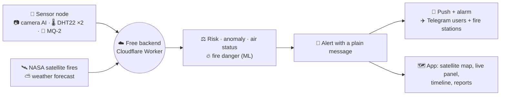

<div align="center">

# Forest Fire Monitor · IoT early warning for forest fires

**Low-cost sensor nodes with on-device camera AI, smoke and heat sensors, a free cloud backend and an app that shows
every sensor on a satellite map, explains every alert in plain words and tells the right people within seconds.**

Put a node in the forest. Forest Fire Monitor watches it every second, learns what is normal for that spot, warns
when the camera sees flames or the air turns smoky, confirms the fire before calling it critical, and guides
responders to it.


[**Quick start**](#-quick-start) ·
[**How it works**](#-how-it-works) ·
[**Features**](#-features) ·
[**Results**](#-results) ·
[**Docs**](#-documentation) ·
[**API**](#-api) ·
[**Project layout**](#-project-layout)

</div>

---

## 🧭 At a glance

> [!TIP]
> **Example.** The camera on Node 01 sees flames, 92% sure, and the smoke sensor jumps far above its normal level.
> Within about 2 seconds every phone following the sensor rings with *"The camera at Node 01 sees flames (92% sure).
> Readings: 41.2 °C, 18% humidity, smoke level 1450. The smoke and heat sensors agree. Check the area now…"*.
> After 2 minutes of continuous fire the alert becomes **CRITICAL**, the nearest fire station gets the message and
> location on Telegram, the map draws the estimated fire area, and responders tap **Directions**.



| | |
|---|---|
| **Problem** | Forest fires are found late: satellites pass a few times a day, watch towers need people, and single smoke sensors cry wolf. When an alarm does come, nobody knows how sure it is or what to do. |
| **Solution** | Nodes that see (camera AI), smell (MQ-2) and feel (two DHT22s) the fire and judge it against what is normal for that spot, a backend that confirms, explains and routes the alert, and an app built for the people who respond. |
| **Guarantee** | Every alert has a written reason and a confidence. Fire is called *critical* only after 2 minutes without a break. Every sensor reports its own health, so a broken camera is never silent. |

### Project objectives

| Objective | Status | Where |
|---|---|---|
| Detect fire early at the node with on-device AI | ✅ Done | camera AI on the ESP32-S3, ≈2.7 s per frame |
| Reduce false alarms | ✅ Done | 75% threshold, 2-minute confirmation, per-node baselines, verdicts |
| Alert the right people in seconds, with clear instructions | ✅ Done | push, alarm, Telegram, fire stations, plain messages |
| Forecast fire danger from weather (ML) | ✅ Done | Indian-data model, ROC AUC 0.85 on unseen states |
| Work without Wi-Fi at the sensor | ✅ Done | the node sends only by LoRa; a gateway on reliable Wi-Fi puts everything online |

---

## 🚀 Quick start

> [!TIP]
> **Just use it.** Install the Android app from
> [Releases](https://github.com/surendar-77/forest-fire-monitor/releases/latest) or open the web app
> <https://forest-fire-3d2f0.web.app>, then **create an account**. New accounts can see every sensor, its location,
> live readings and alerts.

**Develop**

```powershell
flutter pub get
flutter run -d chrome                     # or an Android phone
flutter test ; flutter analyze

cd worker ; npm ci ; npm test             # backend tests
npx wrangler dev                          # run the backend locally
```

**Release**

```powershell
powershell -ExecutionPolicy Bypass -File tool\deploy_web.ps1                         # web app
powershell -ExecutionPolicy Bypass -File tool\release_apk.ps1 -Notes "What changed"  # Android + in-app update
cd worker ; npx wrangler deploy                                                       # backend
```

Full setup (Firebase, Cloudflare, secrets, sensors): [docs/DEPLOYMENT.md](docs/DEPLOYMENT.md).

---

## ⚙️ How it works

### The node and the LoRa gateway

```
ESP32-CAM ──JPEG every 3 s (node's own Wi-Fi "FireDetector")──► ESP32-S3 sensor node
                                   TFLite Micro + ESP-NN ──► Fire / Normal / Smoke (≈2.7 s)
                                   DHT22 zone 1 + zone 2 (2.5 s) · MQ-2 smoke (1 s, fault detection)
                                   └─ LoRa 433 MHz, SF10, 27-byte packet every 1 s (no internet Wi-Fi)
                                            │
                                            ▼
                       LoRa gateway (ESP32 + RA-02 on reliable Wi-Fi)
                         ├─ live values every packet (1 s) ──► Realtime Database
                         ├─ node health every 30 s ──────────► Realtime Database
                         └─ packet every 10 s; alerts at once, then every 5 s ──► backend /lora/data
                                    (history once a minute, risk, anomaly, air status, alert rules)
```

### The backend (Cloudflare Worker, free)

| Every | What it does |
|---|---|
| minute | read each node's ThingSpeak summary → risk score, anomaly score, **air at the sensor**, alert decision; push new alerts; admin requests; Telegram inbox |
| 5 minutes | node online/offline, **sensor-problem alerts** from board health, escalation, roles, heartbeat |
| hour | rollups for graphs, **fire danger (ML)** per node, NASA satellite fires nearby |
| day | delete readings older than 30 days |

### The app (Flutter: Android + web)

Satellite map with live panel → sensor details → Data graphs → Alerts with verdicts and timeline → Reports.

---

## ✨ Features

| | Feature | Details |
|---|---|---|
| 🗺️ | **Live map** | satellite, NASA vegetation and street layers; sensors coloured by risk; estimated fire area and 1-hour spread |
| 📟 | **Live panel** | averaged temperature and humidity, smoke, camera result, risk, **air at sensor** (clean / smoke / gas), today's fire prediction |
| 🔎 | **Sensor details** | live readings, power and restart reason, Wi-Fi signal, memory, chip temperature, camera and sensor health |
| 🚨 | **Clear alerts** | every alert says what was seen, how sure, the readings and what to do; fire pop-up with alarm sound |
| ✅ | **Confirmation** | fire raised to critical only after 2 minutes without a break; then the fire area is drawn |
| 🔧 | **Sensor-problem alerts** | camera silent, sensor not reading, brownout, low battery, weak Wi-Fi, overheating; resolve themselves |
| ✈️ | **Telegram** | users connect their Telegram; fire stations get serious alerts with the location |
| 🧭 | **Directions** | road route to a sensor or fire, the walk at the end, and Google Maps navigation |
| 📈 | **Graphs** | temperature, humidity, smoke, camera, risk; **pinch to zoom, drag to move**; CSV download |
| 🧾 | **Timeline and reports** | each alert's steps with response times; 7/30/90-day reports with PDF and CSV |
| 🎯 | **Camera accuracy** | *Real fire / False alarm* buttons; accuracy card suggests a better threshold |
| 🔥 | **Fire danger** | ML chance of fire today and the riskiest hour, adjusted for forest type |
| 👥 | **Accounts and roles** | open sign-up as viewer; officers respond; admins add sensors and fire stations |
| 📡 | **LoRa link** | the node sends all its data by radio every second; a gateway on reliable Wi-Fi puts live data, health, history and alerts online |
| ⬆️ | **Self-updating** | web and Android apps show "update available" and update in two taps |

<details>
<summary><b>Advantages</b></summary>

<br/>

- **Explainable, not a black box:** every alert carries its reason and the camera's confidence.
- **Fewer false alarms:** a high camera threshold, a 2-minute confirmation, and smoke judged against each sensor's own clean air.
- **Self-monitoring:** each node reports its power, Wi-Fi and sensor health; problems become alerts.
- **Built for responders:** acknowledge, judge, resolve, navigate, and see who did what and when.
- **Learns from people:** verdicts measure the camera's accuracy and will train the next model.
- **Costs nothing to run:** Firebase Spark, Cloudflare Workers Free, ThingSpeak, NASA FIRMS and Open-Meteo.
- **Cheap hardware:** ESP32-S3, ESP32-CAM, DHT22 and MQ-2 modules.

</details>

---

## 📊 Results

| Component | Result |
|---|---|
| Camera AI on the ESP32-S3 | ≈2.7 s per frame with ESP-NN (16 s without) |
| Fire alert to phone | ≈2 s (node → backend → push) |
| Fire-danger model, leave-states-out | ROC AUC **0.848**, PR AUC 0.176, Brier 0.037 ([ml/README.md](ml/README.md)) |
| Fire-danger model, train 2022–23 → test 2024 | ROC AUC **0.879**, PR AUC 0.220 |
| Live feed | 1 update per second; 99%+ uploads delivered on a good link |
| Tests | **44** app + **87** backend, all passing |

> [!NOTE]
> The camera thresholds have not yet been validated on real forest fires; the accuracy card will measure them as
> responders mark alerts *Real fire* or *False alarm*.

---

## 📚 Documentation

| Document | What's inside |
|---|---|
| 📋 [**PRD.md**](PRD.md) | Problem, goals, users, requirements with status, success metrics |
| 🏗️ [**ARCHITECTURE.md**](ARCHITECTURE.md) | Components, data flow, backend jobs, endpoints, alert lifecycle |
| 🤖 [**AGENTS.md**](AGENTS.md) | Rules and conventions for coding tools working on this repo |
| 🎨 [**DESIGN_SYSTEM.md**](DESIGN_SYSTEM.md) | App colours, type, components, plain-language rules |
| ✅ [**QA_REPORT.md**](QA_REPORT.md) | Tests, coverage, defects found and fixed |
| ⬇️ [DOWNLOAD_LINKS.md](DOWNLOAD_LINKS.md) | App downloads, services, data sources, software |
| 🛠️ [docs/TECHNICAL_GUIDE.md](docs/TECHNICAL_GUIDE.md) | Full technical guide: sensors, detection, alerts, ML, releases, limits |
| 🔌 [docs/HARDWARE.md](docs/HARDWARE.md) | Boards, pins, flashing, Wi-Fi self-healing, health report |
| 🚨 [docs/ALERTS.md](docs/ALERTS.md) | Every alert type, threshold, message and who is told |
| ☁️ [docs/DEPLOYMENT.md](docs/DEPLOYMENT.md) | Firebase, Worker, releases, quotas, secrets |
| 🗃️ [docs/DATA.md](docs/DATA.md) | ThingSpeak, Realtime Database, Firestore, CSV formats |
| 🔍 [docs/GAP_ANALYSIS.md](docs/GAP_ANALYSIS.md) | Gaps in forest-fire detection and how this project addresses them |
| 📊 [docs/PROJECT_STATUS_REPORT.md](docs/PROJECT_STATUS_REPORT.md) | Completed, pending and blocked work with evidence |
| 🧪 [docs/PROJECT_AUDIT.md](docs/PROJECT_AUDIT.md) | Audit checklist |
| 🗒️ [docs/WORK_LOG.md](docs/WORK_LOG.md) · [docs/ALL_WORK_DONE.md](docs/ALL_WORK_DONE.md) · [docs/WORK_SUMMARY.md](docs/WORK_SUMMARY.md) | What was done, when, and the before/after |
| 🌲 [docs/FIELD_TRIAL_PACKAGE.md](docs/FIELD_TRIAL_PACKAGE.md) | Package for a forest-department review and field trial |
| 🤖 [ml/README.md](ml/README.md) | Fire-danger model: data, training, evaluation |

---

## 🔌 API

| Method | Path | Purpose |
|---|---|---|
| `POST` | `/alert` | Fire / smoke / risk alert from a node (node id + key) |
| `POST` | `/lora` | LoRa link report from a receiver gateway (gateway id + key) |
| `POST` | `/lora/data` | A node packet relayed by the gateway; used when the node's own Wi-Fi feed is quiet |
| `GET` | `/apk/version.json` | Latest Android build, version and notes (in-app update) |
| `GET` | `/apk/ForestFireMonitor-<version>.apk` | Android download |
| `GET` | `/` | Backend version |

The app reads and writes Firestore and the Realtime Database directly, guarded by `firestore.rules` and
`database.rules.json`; admin actions go through `adminRequests` / `roleRequests` documents that the backend checks.
Details: [ARCHITECTURE.md](ARCHITECTURE.md).

---

## 🧪 Tests

```powershell
flutter test                     # 44 tests: models, fire areas, sensor details, accuracy card, timeline, reports, CSV
cd worker ; npm test             # 87 tests: alert rules, confirmation, health alerts, messages, air status, ML, Telegram
cd rules-tests ; npm test        # security-rules tests (Firebase emulator, Java 11+)
```

Details in [QA_REPORT.md](QA_REPORT.md).

---

## 🗂️ Project layout

<details>
<summary><b>Expand the tree</b></summary>

```
lib/                     Flutter app
├── screens/             home_map, data, alerts, reports, settings, login, add_sensor, fire_stations, app_shell
├── widgets/             live_overlay_strip, node_details_sheet, trend_chart, fire_danger_card, urgent_alert_dialog …
├── services/            node_repository, auth, fcm, notification, history, report_export, fire_station, app_update
├── models/              node (LocalAir, FireDanger, LoraLink), alert, reading, live_reading, node_health, terrain
└── utils/               fire_areas, alert_timeline, alert_report, friendly, risk_utils
worker/                  Cloudflare Worker backend (TypeScript)
└── src/                 index (crons, endpoints), alertRules, health, alertMessages, localAir, anomaly,
                         fireDanger, spread, terrain, firms, fcm, telegram, fireServices, nodes, firestore, rtdb
backend/                 Python version of the backend + admin CLI (self-host alternative)
ml/                      fire-danger model training (Indian data)
web/                     web shell, service worker, privacy policy
tool/                    deploy_web.ps1, release_apk.ps1
test/  rules-tests/      app tests, security-rules tests
docs/                    guides and reports
firestore.rules  database.rules.json  firebase.json
```

The node firmware (`ForestFire_S3.ino`, `ESP32CAM_Uploader.ino`, `LoRa_Receiver.ino`) is kept outside the repository
because it contains secrets; see [docs/HARDWARE.md](docs/HARDWARE.md).

</details>

---

## 📄 Licence

© 2026 surendar-77. All rights reserved. Not licensed for copying, modification or redistribution.
